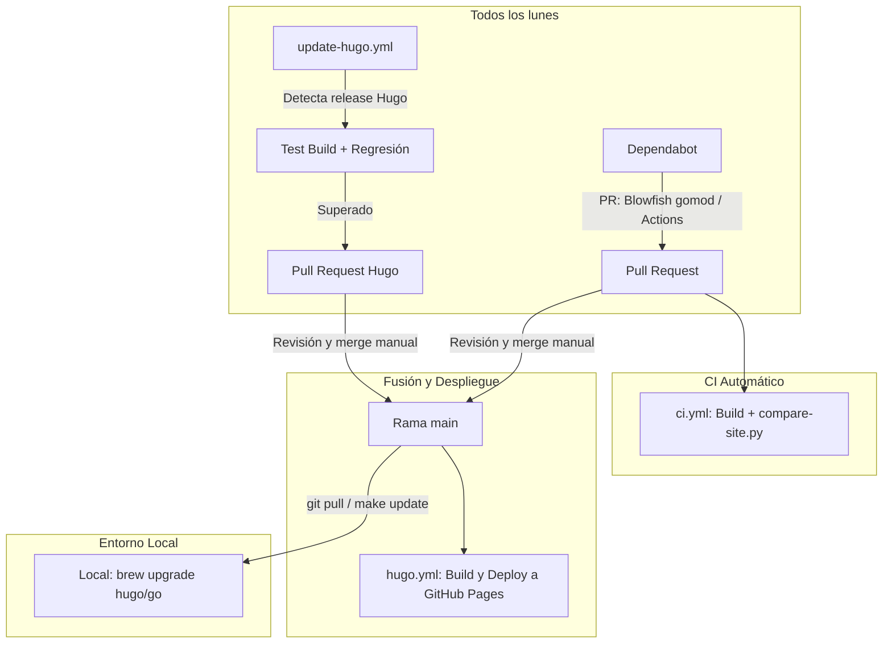

# Blog Personal - Agustín Ventura

Fuentes del blog personal [agustinventura.dev](https://www.agustinventura.dev/), generado con [Hugo](https://gohugo.io/) y el tema [Blowfish](https://blowfish.page/), alojado en GitHub Pages.

---

## 🛠️ Comandos locales (`Makefile`)

El proyecto incluye un `Makefile` para facilitar el flujo de desarrollo diario y la sincronización:

| Comando | Descripción |
|---|---|
| `make serve` | Inicia el servidor de desarrollo local (`hugo server -D`) tras verificar que las versiones de Hugo y Go coinciden. |
| `make build` | Compila el sitio estático en `./public/` (`hugo --gc --minify`) para producción tras chequear versiones. |
| `make check` | Verifica si la versión instalada de Hugo en tu máquina coincide con `.hugo-version` y si Go cumple los requisitos de `go.mod`. |
| `make compare` | Compila el sitio y ejecuta el comparador contra la versión publicada en producción para detectar posibles regresiones de contenido. |
| `make update` | Hace `git pull`, actualiza los módulos de Hugo (`hugo mod get -u && hugo mod tidy`) y valida versiones. |
| `make test` | Ejecuta los tests unitarios de los scripts auxiliares en Python. |

---

## 🔄 Actualizaciones automáticas y sincronización

El repositorio cuenta con un sistema automatizado para mantener actualizados Hugo, el tema Blowfish y las GitHub Actions sin roturas imprevistas.



### 1. Fuentes de la verdad de las versiones
- **Hugo**: Fichero [`.hugo-version`](.hugo-version). Contiene el número exacto de versión utilizado tanto en local como en GitHub Actions.
- **Blowfish y Go**: [`go.mod`](go.mod). Controla la versión del tema Blowfish como Hugo Module y la versión mínima requerida del compilador de Go.
- **GitHub Actions**: Definidas en cada fichero dentro de [`.github/workflows/`](.github/workflows/).

### 2. Flujo de actualización (Lunes)
1. **Blowfish y GitHub Actions**: Dependabot revisa semanalmente si hay nuevas versiones de módulos Go (`gomod`) y de Actions (`github-actions`) y abre PRs automáticas etiquetadas con `dependencies`.
2. **Hugo**: El workflow `update-hugo.yml` consulta la API de GitHub en busca de la última versión estable de Hugo. Si detecta una nueva:
   - Instala dicha versión candidata.
   - Compila el sitio y ejecuta la suite de validación de regresión contra producción.
   - Si todo es correcto, genera una PR con la actualización de `.hugo-version` y el enlace a las release notes oficiales.

### 3. Comprobación de regresión de contenido
Para garantizar que una actualización de dependencias o de Hugo no "rompa" el blog ni pierda contenido silenciosamente:
- El script [`scripts/compare-site.py`](scripts/compare-site.py) descarga el `sitemap.xml` y las páginas publicadas en `https://www.agustinventura.dev`.
- Compara que **no desaparezca ninguna URL** existente.
- Comprueba que los títulos (`<title>`) y encabezados (`<h1>`) no varíen.
- Valida que el contenido de texto visible, imágenes y bloques de código no se reduzcan más de un **5%** (umbral de tolerancia configurable).
- Esta verificación se ejecuta automáticamente en el CI de cada PR (`ci.yml`) y antes de abrir una PR de Hugo (`update-hugo.yml`).
- También puedes ejecutarla en local cuando quieras con `make compare`.

### 4. Qué hacer al recibir una Pull Request
1. Entra a la PR generada (por Dependabot o por el actualizador de Hugo).
2. Revisa las notas de la versión enlazadas.
3. Asegúrate de que los checks de validación hayan pasado en verde.
4. Realiza el **Merge** manual a `main`. El workflow `hugo.yml` se disparará automáticamente y desplegará la nueva versión a GitHub Pages.

### 5. Cómo sincronizar tu entorno local
Tras fusionar una actualización en GitHub:
1. En tu terminal local, ejecuta:
   ```bash
   make update
   ```
2. Si el script `scripts/check-versions.sh` te advierte de un desfase en Hugo o Go:
   ```bash
   brew upgrade hugo
   brew upgrade go
   ```
3. Ejecuta `make serve` para continuar editando tus artículos con el entorno alineado.

### 6. Requisitos de configuración en GitHub
- En los ajustes del repositorio (**Settings** → **Actions** → **General**), bajo la sección *Workflow permissions*, debe estar marcada la opción **"Allow GitHub Actions to create and approve pull requests"** (permite a `update-hugo.yml` crear las PRs semanales).
